# Memory-ops high-level architecture

Status: **implemented and evaluated; production release blocked by measured readiness failures**.

The editable source is [`high-level-architecture.mmd`](high-level-architecture.mmd).

## How to read the diagram

- Start at **Clients** and follow the labelled write or read branch from left to right.
- **Solid dark** arrows are synchronous operations.
- **Dashed purple** arrows are asynchronous, retryable work.
- **Red** is a denied path; **grey dotted** lines carry metadata only.
- Operations inside each box define that component’s high-level responsibility, not implementation detail.

## End-to-end journeys

### Write: remember, correct, or forget

The client sends a memory operation. The API validates and routes it, then the trust boundary authenticates the principal, derives tenant/workspace scope, and applies deny-first policy. The responsible memory domain commits an immutable version, current pointer, lifecycle change, and outbox event atomically. Workers consume the outbox later to update or purge rebuildable indexes. The response contract returns the authoritative write acknowledgement.

### Read: retrieve or build context

The same API and policy boundary authorize the read before domain-specific retrieval begins. Derived indexes return candidate IDs only. Context Assembly revalidates their scope, hydrates current canonical versions, applies the token budget, and returns labelled domain sections with citations, conflicts, warnings, abstention, or degraded status.

### Denied operation

If identity, scope, grants, or machine policy reject an operation, processing stops before domain access. Only a content-free audit record is emitted.

### Evaluation control

Observability receives content-free metadata from the request and worker paths. Versioned datasets, baselines, safety checks, and protected holdouts determine whether a capability can progress beyond review or shadow mode.

## System boundaries

| Component | Owns | Must not do |
|---|---|---|
| Clients | User/agent intent and typed requests | Supply trusted tenant authority |
| API Gateway | Contract validation, versioning, idempotency, routing | Bypass policy or invent memory semantics |
| Auth & Policy | Identity, grants, scope, deny-first machine rules | Treat retrieved text as authorization |
| Memory Domains | Domain-specific meaning and authority | Flatten user, agent, and organization truth together |
| Canonical Store | Immutable versions, current pointers, lifecycle, grants, outbox | Treat indexes as canonical truth |
| Workers & Indexes | Rebuildable enrichment, indexing, retries, purge work | Publish without revalidating policy and destination |
| Context Assembly | Authorized retrieval, canonical hydration, budgeting, citations | Return stale, revoked, deleted, or unauthorized content |
| Observability & Evaluation | Content-free telemetry and evidence-based promotion gates | Store raw protected content in ordinary telemetry |

## Verified V1 boundary

The implemented V1 is a modular API plus independently runnable worker, PostgreSQL, and
S3-compatible document storage. Redis, Kafka, Kubernetes, dedicated vector infrastructure, and
graph infrastructure remain outside the active architecture until a measured evaluation justifies
them.

## Production evidence

M8 exercised the database and API profile at 100 tenants, 1,000 active principals, 1,000,000
canonical memories, and 10,000 organizational documents. Hard-safety observations remained at zero
for cross-tenant disclosure, post-revocation disclosure, and acknowledged-write loss. The live
migration drill proved rollback with zero data loss.

That evidence is a **NO-GO**, not a deployment approval. Throughput was 1.767 QPS against 25 QPS;
P95/P99 latency was 54,298.640/67,156.041 ms against 750/1,500 ms; P95/P99 index lag was
1,226.411/1,235.669 seconds against 30/120 seconds; and 214 operations remained after the
five-minute recovery window. The source-object and memory-growth limitations shown in the diagram
also remain open. See the [M8 evidence boundary](m8/README.md) and
[operations guide](../operations/operations-guide.md).
